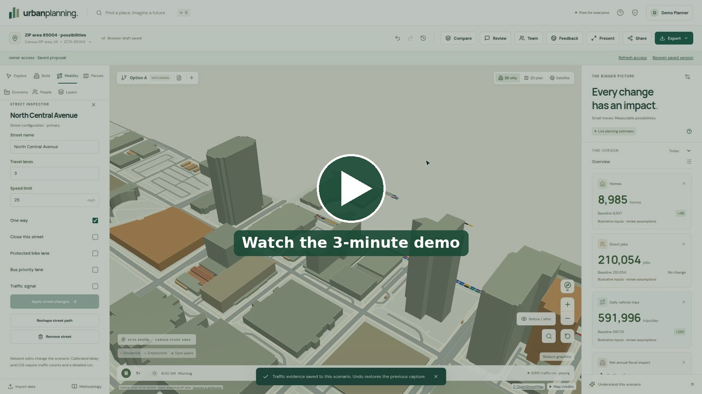
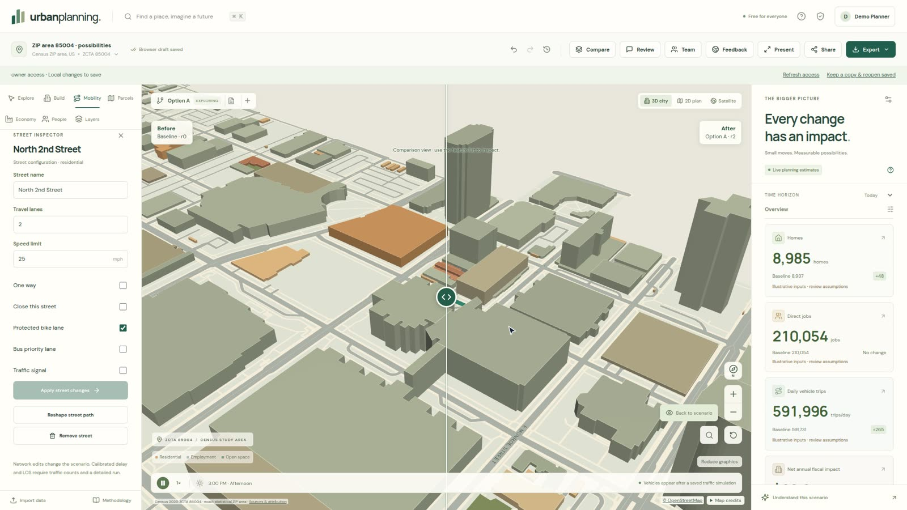
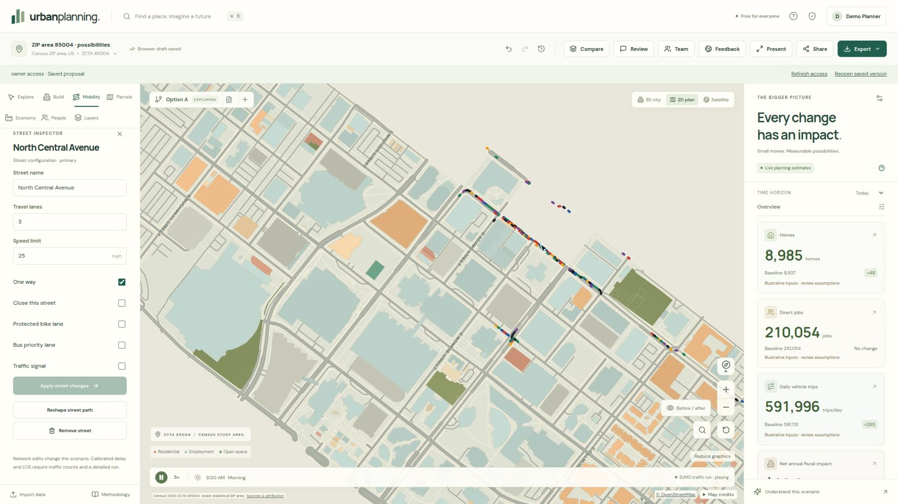
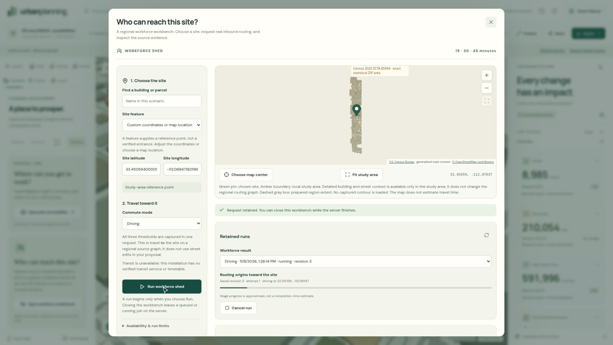
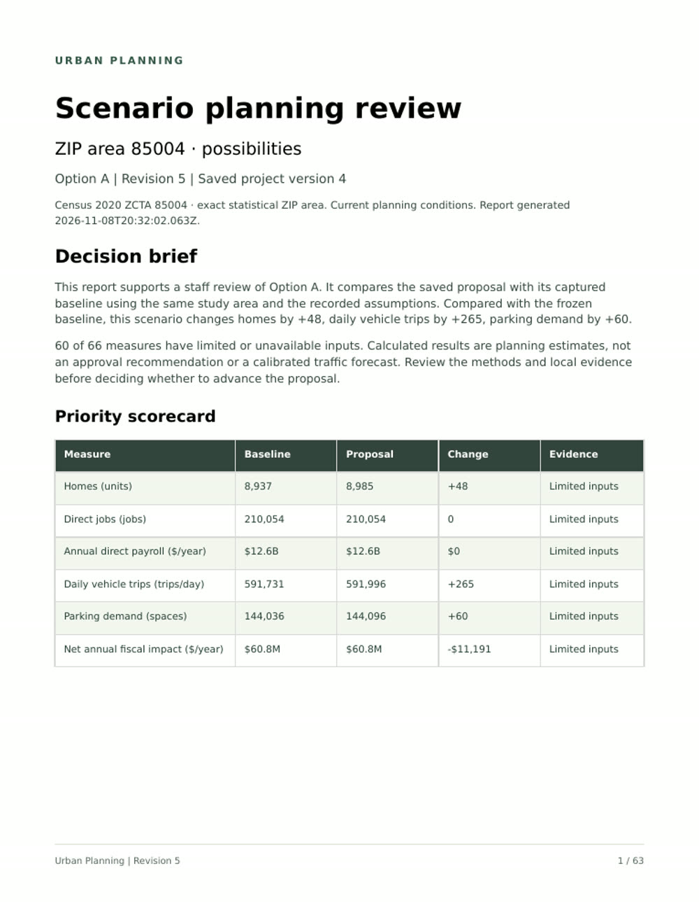
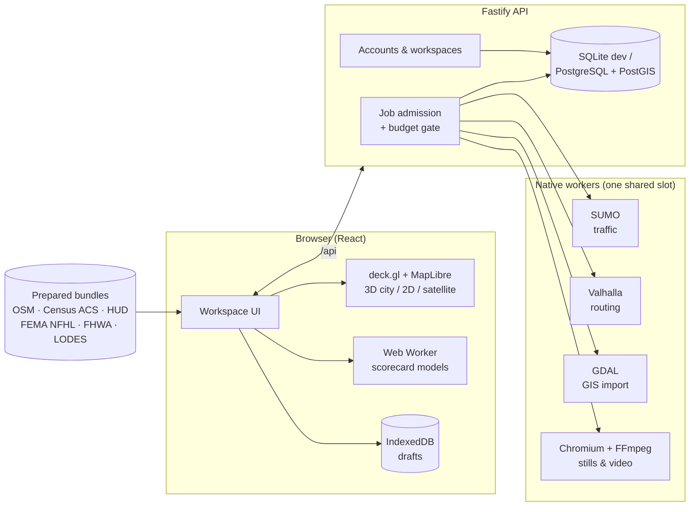

<div align="center">

# urbanplanning.

### Type a ZIP code. Change the city. See what happens.

A browser-based digital twin for planners and economic developers. Drop a building, re-stripe a street,<br>
and watch the homes, jobs, trips, flood exposure, commute shed, and real microscopic traffic respond.


<br>

[](https://github.com/VincentAZ/urban-planning/releases/download/demo-2026-11/urban-planning-demo.mp4)

<sub>▶ <a href="https://github.com/VincentAZ/urban-planning/releases/download/demo-2026-11/urban-planning-demo.mp4"><b>Watch the demo</b></a> (3 min, MP4, <a href="https://github.com/VincentAZ/urban-planning/releases/download/demo-2026-11/urban-planning-demo.srt">subtitles</a>), recorded live from the working product. The colored dashes on Central Avenue are vehicles from a real SUMO run, not an animation.</sub>

</div>

---

## Why this exists

A rezoning, a new distribution center, or a road diet usually gets evaluated with disconnected tools: GIS for parcels, a traffic consultant for trip generation, a spreadsheet for fiscal impact, and renderings for the public meeting. Each one takes weeks and costs five to six figures, and none of them can answer *"what if we added 300 units instead of 200?"* while you're still in the room.

**Urban Planning puts all of that in one map.** Open a real place built from public data, change it, and every edit recomputes a scorecard you can defend. Each number links to its formula, its inputs, and its sources.

> **No smoke and mirrors.** Everything below runs for real: real OpenStreetMap, Census, HUD, FEMA, and FHWA data; real model calculations; and real SUMO, Valhalla, GDAL, and Chromium/FFmpeg processes. When a value is only an assumption, the app labels it *illustrative*.

## What you can do

| | |
|---|---|
| 🗺️ **Open a real place** | Search a ZIP, city, address, or map point. Prepared areas (**85004** Phoenix, **60601** Chicago) load exact Census ZCTA boundaries, OSM buildings and streets, and ACS community context with margins of error. Switch between 3D city, 2D plan, and satellite. |
| 🏗️ **Author a proposal** | Place presets (apartments, townhomes, hospital…) or draw footprints with courtyards and wings, then set mixed-use program, homes, jobs, and parking. Draw, reshape, or re-configure streets with lanes, speed, bike lanes, bus priority, and closures. Full undo/redo, branching alternatives, and a draggable **before/after** reveal. |
| 📊 **Live scorecard** | Homes, jobs, daily trips, parking, fiscal impact, and more update on every edit. Click any number to see its formula, its inputs, and the sources behind them. |
| 🚗 **Traffic (SUMO)** | **One click** generates about 2,000 synthetic rush-hour trips and runs a microscopic SUMO simulation on the real street network. The map then plays back the executed vehicles, baseline vs proposal. |
| 👷 **Workforce shed** | Real Valhalla routing to the site at 15, 30, and 45 minutes by car or on foot, with Census education and occupation estimates for the people who can reach it. |
| 💼 **Jobs accessibility** | Counts primary jobs reachable from any origin from the complete Arizona LODES workplace inventory. |
| 🌊 **Flood screening** | Attach FEMA's effective flood map (NFHL) and screen every baseline and proposed footprint against the Special Flood Hazard Area. |
| 🏠 **Housing affordability** | HUD FY2026 income limits by household size, followed through full monthly rental and ownership costs. |
| 💰 **Fiscal & retail** | Fiscal studies built from your jurisdiction's own levy and service costs, each one cited. Retail gap screening compares cited resident demand with local sales, one category at a time. |
| 📥 **GIS import** | GeoJSON, zipped Shapefiles, and DXF go through private inspection, coordinate placement, field mapping, and an exact preview before one undoable apply. |
| 🎤 **Present & export** | Guided tours, read-only public snapshots, a PDF/Word staff report, XLSX/CSV/GeoJSON/Shapefile, 4K stills, and MP4 fly-throughs rendered in an isolated container. |
| 👥 **Collaborate** | Free accounts, workspaces, invitations, review comments, saved versions, and browser drafts that survive reloads. |

## A closer look

<table>
<tr>
<td width="50%"><br><sub><b>Before / after.</b> The locked baseline and the proposal, on the same camera.</sub></td>
<td width="50%"><br><sub><b>SUMO playback.</b> Executed vehicles from the 7–8 AM study period.</sub></td>
</tr>
<tr>
<td width="50%"><br><sub><b>Who can reach this site?</b> Real inbound routing, retained and reproducible.</sub></td>
<td width="50%"><br><sub><b>Staff report.</b> Decision brief, scorecard, and evidence in one export.</sub></td>
</tr>
</table>

## Quick start

**Requirements:** Node.js ≥ 22.13, Corepack, and a WebGL2 browser. Docker is optional; you need it for PostGIS, routing, and the native GIS, traffic, and media workers.

```bash
corepack pnpm install
corepack pnpm dev
```

Open **http://localhost:5173**. Vite serves the web app and proxies `/api` to Fastify on `:3001`. The prepared bundles for 85004, 60601, and Roosevelt Row, plus the national ACS cache, ship in `public/data`, so you can explore and edit without an API key, account, or paid provider.

Without `DATABASE_URL`, the API stores data locally in `.local/api-state.json.sqlite`. To run on PostGIS, see [storage](docs/STORAGE.md) and [API setup](apps/api/README.md).

### Full demo stack (every workbench live)

ZIP **85004** is the one area prepared with data for every workbench. The [demo runbook](docs/DEMO.md) walks through the whole setup:

```bash
corepack pnpm exec tsx scripts/demo-setup.ts   # .env, flood + housing catalogs, budget gate
docker start urban-planning-routing            # Valhalla on :8002
corepack pnpm dev
```

## How it works



- **Deterministic models** in `packages/models` run in a Web Worker, so the scorecard recomputes instantly on every edit. Every result carries its provenance.
- **Heavy work** (traffic, routing, GIS conversion, and media) runs as durable server jobs behind capacity admission and an administrator-controlled **$300/month operating budget gate**. The app stays free for users, and costly work pauses before the budget runs out.
- **Evidence is frozen.** Saved projects, public snapshots, and exports keep the exact data and method versions they were computed with, so a refreshed catalog never silently changes a published number.

## Repository layout

| Path | What lives there |
|---|---|
| `apps/web` | React workspace, map renderer, Web Worker calculations, public snapshot views |
| `apps/api` | Fastify API, auth, tenant authorization, persistence, job workers, imports and exports |
| `packages/core` | Shared geography, scenario, command, result, and provenance contracts |
| `packages/models` | Deterministic analytical models and their [methodology](packages/models/METHODOLOGY.md) |
| `scripts` | Data preparation (ACS, FEMA, HUD, LODES, traffic networks), migrations, native workers, demo video pipeline |
| `public/data` | Prepared geographic bundles, immutable source archives, national ACS cache |
| `tests/e2e` | Playwright browser workflows |

## Testing

```bash
corepack pnpm test        # Vitest unit + integration
corepack pnpm typecheck
corepack pnpm build
corepack pnpm test:e2e    # Playwright (Chromium)
```

The suite has 220+ test files covering models, API, persistence, and real GIS/SUMO/media execution, plus Playwright workflows for editing, saving, snapshots, and exports. Live PostgreSQL tests are opt-in through `TEST_DATABASE_URL`.

## Honest status

This is a **working product preview**, not the finished national product described in the [product requirements](<Urban Planning — Product Requirements.md>).

- ✅ Real data, real computation, documented assumptions, and microscopic traffic simulation in prepared areas.
- ⚠️ Starting coefficients (trip rates, fiscal defaults) are labeled **illustrative** until replaced with local figures.
- ⚠️ The traffic run is a synthetic-demand 7–8 AM study period, **not a calibrated forecast**.
- ❌ No transit, no nationwide coverage yet, and no production deployment.

The [implementation status ledger](docs/IMPLEMENTATION_STATUS.md) tracks exactly what works, what's partial, and what's missing.

## Documentation

| Topic | Doc |
|---|---|
| Everything in depth (flows, data, methods, verification) | [docs/REFERENCE.md](docs/REFERENCE.md) |
| Demo runbook | [docs/DEMO.md](docs/DEMO.md) |
| Model methods & limitations | [packages/models/METHODOLOGY.md](packages/models/METHODOLOGY.md) |
| Traffic: [SUMO runtime](docs/TRAFFIC_RUNTIME.md) · [Census commute](docs/TRAFFIC_COMMUTE.md) | |
| Workforce: [shed](docs/WORKFORCE.md) · [jobs accessibility](docs/ACCESSIBILITY.md) · [routing](docs/ROUTING.md) | |
| Evidence: [flood](docs/FLOOD.md) · [housing](docs/HOUSING.md) · [fiscal](docs/FISCAL.md) | |
| Platform: [storage](docs/STORAGE.md) · [GIS import](docs/GIS_RUNTIME.md) · [media](docs/MEDIA.md) · [budget](docs/BUDGET.md) · [capacity](docs/NATIVE_CAPACITY.md) | |
| Plan & status | [implementation plan](docs/IMPLEMENTATION_PLAN.md) · [status ledger](docs/IMPLEMENTATION_STATUS.md) |

## License

The original application code is open source under the [MIT License](LICENSE), copyright © 2026 Vincent Serpico.

Data and third-party components keep their own licenses and terms. The MIT grant does not relicense OpenStreetMap data (ODbL, © OpenStreetMap contributors), Census/HUD/FEMA/FHWA source data, Esri or MapTiler imagery, the DejaVu fonts, or the SUMO, Valhalla, and GDAL engines. Keep the attributions shown in the app and in each prepared bundle.

<div align="center">
<br>
<b>Small moves. Measurable possibilities.</b>
</div>
